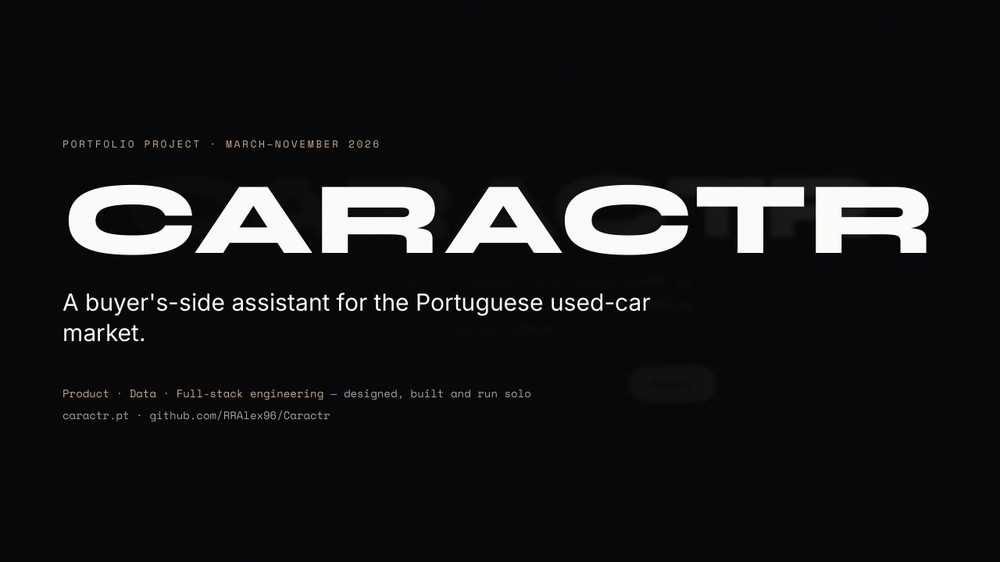

# Caractr

[](https://github.com/RRAlex96/Caractr/actions/workflows/ci.yml)

A buyer's-side assistant for the Portuguese used-car market. It picks the right model for your life, checks any listing against like-for-like cars, warns about known engine faults, and tells you what to offer.

I designed, built and ran it on my own between March and November 2026. **Status:** archived portfolio project. The site stays live at [caractr.pt](https://caractr.pt) (in European Portuguese).

**→ Start with the [guide for reviewers](docs/GUIDE.md) or the [9-slide deck (PDF)](docs/deck/caractr-deck.pdf).**

[](docs/deck/caractr-deck.pdf)

## What it does

- **Recommender:** 8 questions about your life (not specs) give a ranked shortlist of models with monthly running costs, and a refine step when nothing fits.
- **Ad analysis:** paste a Standvirtual, OLX or dealer link and get:
  - a verdict;
  - the price against comparable listings;
  - known faults for that engine and what to check;
  - a five-stage negotiation plan with ready-to-send messages.
- **Public guides:** over 400 model and engine pages, with price by year from 43k listings, sourced faults, repair costs and manufacturer cover.

## Highlights

- **Data treated as an engineering problem.**
  - 456 models, 873 generations and 1,504 engines, each row with its source.
  - Postgres constraints that refuse impossible rows.
  - A 46-check data audit, run in CI, in production and daily (latest production score: 98/100).
  - The whole database rebuilt from the repository on every push.
- **Robust extraction from hostile sources.**
  - Layered parsing, graded for quality.
  - A token-locked relay around marketplace bot-blocking.
  - A paste fallback, so analysis never depends on one path.
- **Honest output.**
  - Comparison pools segmented by fuel and power, with trimmed medians and minimum samples.
  - No price verdict when there are too few comparables.
  - The LLM writes words, never numbers ($0.015 per analysis, measured).
- **Product judgement.** I tested the business against free alternatives and stopped when the evidence said so. The guide's [section 7](docs/GUIDE.md#7-product-judgement-why-i-stopped) explains why.
- **Volume:** 816 tests and 42 merged pull requests.

## Stack

| Layer | Tools |
|---|---|
| **Frontend** | Next.js 16, React 19, TypeScript, Tailwind 4 (Vercel) |
| **Backend** | FastAPI, SQLAlchemy, PostgreSQL (Render, Neon) |
| **Scraping** | httpx, BeautifulSoup |
| **LLM** | Gemini Flash, with a fallback model and a template fallback |
| **CI and operations** | GitHub Actions: tests, frontend build, database rebuild and audit, daily health check, monthly market snapshot |

## Run it

See [DEPLOY.md](DEPLOY.md). In short:

```bash
cd backend && pip install -r requirements.txt && python -m scripts.load_seed --twice   # needs DATABASE_URL
uvicorn app.main:app --reload
cd frontend && npm install && npm run dev
```

## Notes

- **AI pair-programmer:** built with Claude Code. I set direction, data rules and acceptance criteria, and reviewed the work. See [how it was built](docs/GUIDE.md#8-how-it-was-built).
- **Licence:** the code is shared for review. No licence is granted.
