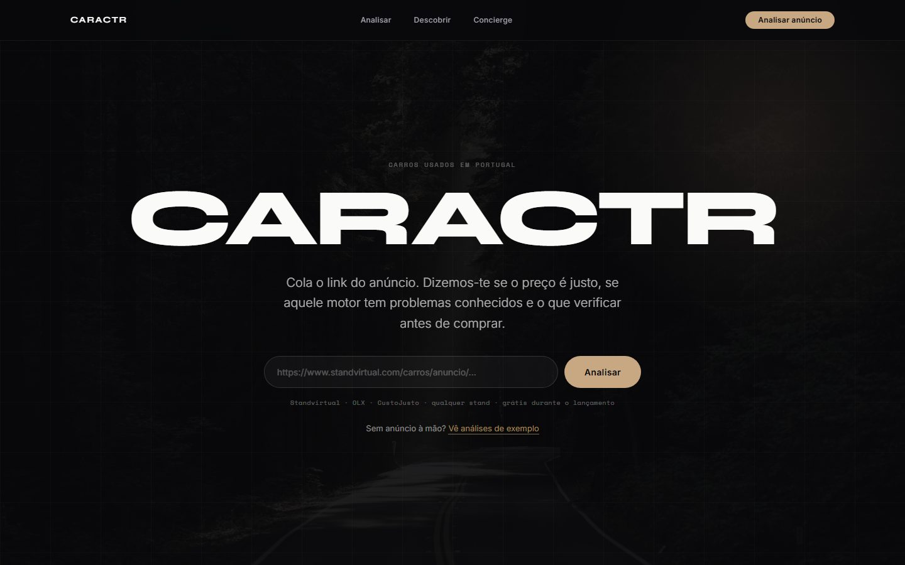
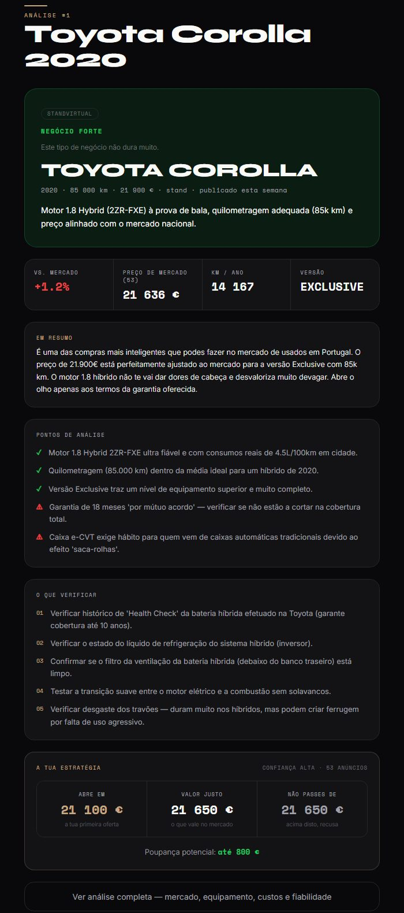
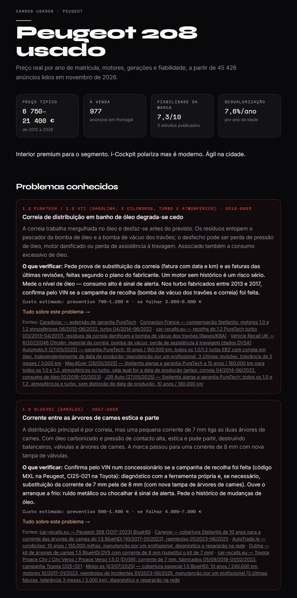
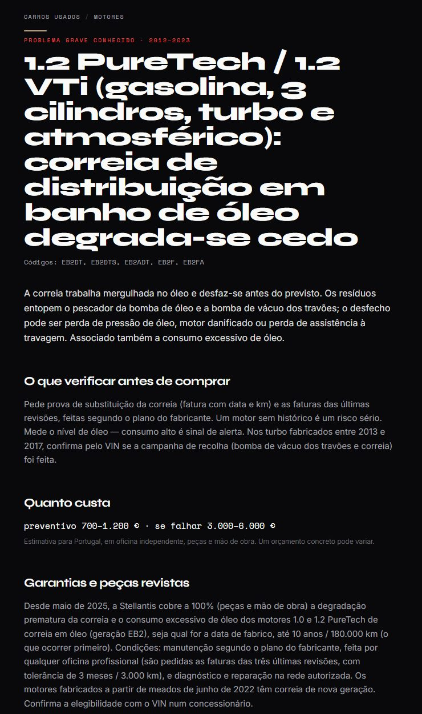

# Caractr: a guide for reviewers

A buyer's-side assistant for the Portuguese used-car market. I designed, built and ran it on my own between March and November 2026, then stopped once I'd tested the business and concluded it wasn't one.

- **Live:** [caractr.pt](https://caractr.pt) (the interface is in European Portuguese)
- **Deck:** [caractr-deck.pdf](deck/caractr-deck.pdf) (9 slides)
- **Status:** archived as a portfolio project. The site stays online; nothing new is being built.



---

## 1. In one minute

Buying a used car in Portugal means negotiating with someone who knows more than you do. The marketplaces are paid by sellers. Used imports reached 120,787 cars in 2025, and 55% of imported cars carry a damage record (carVertical).

Caractr sits on the buyer's side and offers three ways in:

| | What the user does | What they get |
|---|---|---|
| **Recommender** | Answers 8 questions about their life (not specs) | A ranked shortlist of models with monthly running costs, and a "refine" step when nothing fits |
| **Ad analysis** | Pastes a Standvirtual, OLX or dealer link | A verdict, the price against like-for-like listings, known faults for that engine, what to check, and a negotiation plan with ready messages |
| **Public guides** | Lands from a search engine | Over 400 model and engine pages: price by year from 43k listings, sourced faults, repair costs, manufacturer cover |

**What I'd like you to take away:**
1. **I can ship a full product alone:** Next.js frontend, FastAPI backend, Postgres, scrapers, an LLM, CI and production operations.
2. **I treat data quality as an engineering problem,** with sources, constraints, audits and regression tests.
3. **I make product calls from evidence.** That includes killing the project when the evidence said so (section 7).

## 2. Where to look

| You have | Look at |
|---|---|
| **5 minutes** | The [deck](deck/caractr-deck.pdf), then one example analysis on [caractr.pt/exemplos](https://caractr.pt/exemplos) |
| **15 minutes** | Sections 4–7 of this guide, then [`negotiation.py`](../backend/app/services/negotiation.py) with [its tests](../backend/tests/test_negotiation_plan.py). It is small, self-contained and shows how I turn research into code |
| **30 minutes** | The data layer: [`data_audit.py`](../backend/app/services/data_audit.py) (46 checks), [`migration_v64_safeties.sql`](../backend/seeds/migration_v64_safeties.sql) (constraints), [`known_engine_issues.json`](../backend/seeds/known_engine_issues.json) (sourced fault entries) and [`ci.yml`](../.github/workflows/ci.yml), which rebuilds the whole database from the repository on every push |

## 3. The product

| Ad analysis | Model page | Engine page |
|---|---|---|
|  |  |  |

**The ad analysis** is the core of the product.
- **Verdict:** a verdict (strong, fair, caution or avoid) with one reason a non-expert can read.
- **Price check:** the price against comparable listings, with the number of listings and the confidence shown. When there are too few comparables, it says so instead of inventing a number.
- **Engine checks:** what to check for that specific engine.
- **Negotiation:** an opening offer, a fair value and a walk-away price, plus a five-stage plan:
  1. first contact;
  2. the visit;
  3. the offer;
  4. counter-offers;
  5. the close.

  Each stage comes with messages the buyer can copy or send by WhatsApp.

## 4. Architecture

```
Browser ──► Next.js 16 / React 19 (Vercel) ──► FastAPI (Render) ──► PostgreSQL (Neon)
                       │                              │
                       │                              ├── scrapers (httpx, layered parsing)
                       │                              │      └─ on HTTP 403 → token-locked relay on Vercel
                       └── /api/fetch-ad (relay) ◄─────┘
                                                      ├── Gemini Flash: plain-language narrative only
                                                      └── market comparison: live search + monthly snapshot

GitHub Actions: CI (tests, frontend build, DB rebuilt from seeds + audit) · daily health check · monthly market snapshot
```

**What happens when someone pastes an ad** (entry point: `analyse_listing` in [`ad_analysis_service.py`](../backend/app/services/ad_analysis_service.py)):

1. **Fetch.** Standvirtual and OLX answer 403 to cloud IPs. The backend retries through a relay on Vercel ([`relay.py`](../backend/app/scrapers/relay.py), [`route.ts`](../frontend/app/api/fetch-ad/route.ts)). The relay is locked by a shared token and a domain allowlist. If every fetch fails, the user is offered a box to paste the ad text instead.
2. **Extract.** Fields are read in order of trust: the page's own JSON, then JSON-LD, then the HTML, then Portuguese text patterns. Each result gets a data-quality grade.
3. **Identify.** The ad is matched to brand, model, generation and engine in the catalogue. A model that isn't in the catalogue is registered rather than fuzzy-matched to a different one.
4. **Price.** Comparable listings are searched live: same generation, fuel and power band. They are adjusted for year and km, with a trimmed median and a minimum sample size. The monthly snapshot is the fallback.
5. **Warn.** Curated engine faults and official recalls are matched by engine and year ([`known_issues.py`](../backend/app/services/known_issues.py)).
6. **Explain.** The LLM writes the plain-language narrative. Every number it is given was computed in code, and the prompt forbids it from inventing others. Measured cost: **$0.015 per analysis**.
7. **Negotiate.** A deterministic plan is built from the market numbers and the warnings ([`negotiation.py`](../backend/app/services/negotiation.py)).

**The recommender** ([`recommend_service.py`](../backend/app/services/recommend_service.py)):
- builds a profile from the answers, filters by budget, powertrain and new/used, and scores fit, reliability and ownership cost;
- estimates the monthly running cost from official fuel and electricity prices ([`energy_costs.py`](../backend/app/services/energy_costs.py));
- has a persona regression script ([`recommender_personas.py`](../backend/scripts/recommender_personas.py)) that catches ranking changes before they ship.

## 5. The data layer

The product is only as good as its data, so most of the engineering effort went here.

| Layer | How it works |
|---|---|
| **Coverage** | 49 brands, 456 models, 873 generations, 1,504 engines. A market snapshot of 43,646 listings gives price by model and year |
| **Sources** | Generation years and engine specs were checked row by row. Each row records the page it was checked against (`generations.source_url`, `engines.source`). Brand reliability comes from six published studies |
| **Constraints** | Postgres refuses impossible rows: implausible power or consumption, duplicate models, two generations claiming the same year ([`migration_v64_safeties.sql`](../backend/seeds/migration_v64_safeties.sql)) |
| **Audit** | [`data_audit.py`](../backend/app/services/data_audit.py) runs 46 checks in six dimensions (structure, plausibility, market coverage, freshness, provenance, safeties) and scores the result. It runs in CI, in production and daily. The last production score was 98/100 |
| **Reproducibility** | [`load_seed.py`](../backend/scripts/load_seed.py) builds the whole database from the repository. CI does it on an empty Postgres on every push, applying recent migrations twice to prove they are idempotent |
| **Changes** | Every change is a numbered, idempotent migration, rehearsed twice on a local copy, applied after a backup, then audited |
| **Editorial content** | The 23 engine-fault entries carry sources, what to check, repair costs and warranty cover. Each one needed an independent review scoring at least 8/10 before publication, and "critical" claims need an official or press source |

## 6. Engineering decisions worth reading about

Each of these started as a real bug that broke trust. Each one is now a regression test.

- **A plug-in hybrid priced against base diesels** showed as "29% overpriced", which was pure noise. Comparison pools are now segmented by fuel and power before any statistic is computed.
- **A promoted Ferrari inside a "Golf 2020+" search** set a Golf's price at €52,000. Listings are now validated (brand, model, generation years, placeholder prices) before they count, and published prices use a trimmed median with a minimum sample.
- **Fuzzy recall matching** pinned an S-Class recall on an A-Class and an ID.4 recall on an ID.3. Matching is now whole-word and year-bound.
- **A Range Rover Velar resolved to an Evoque** because both share the word "range". Unknown models are now registered on first sight instead of fuzzy-matched.
- **Every recall silently failed to save** because of a SQLAlchemy pitfall: `:param::jsonb` is never bound. A guard test now fails the build if that pattern appears.
- **Red warnings on 58% of cars** were noise, not signal. Warnings are now rare and actionable: only sourced, engine-specific faults, worded to inform rather than alarm, and always naming the manufacturer's cover where it exists.
- **Generic negotiation advice** was replaced by a plan built on negotiation research:
  - precise offers rather than round ones;
  - concessions that shrink step by step;
  - a polite first message that asks about maintenance, not the engine's reputation;
  - a dealer is asked for the legal warranty rather than a discount on a "fixed" price.

**By the numbers:**

| Measure | Count |
|---|---|
| Tests | 816 |
| Merged pull requests | 42 |
| Python | about 29k lines |
| TypeScript | about 12k lines |
| SQL migrations and seeds | 37 |

## 7. Product judgement: why I stopped

I didn't only build features. I tried to make it a business, and measured each step.

**What I tried:**
- **Monetisation.** A one-time Buyer Pass (not a subscription, since people buy a car every 5–8 years) and two concierge tiers.
- **A launch bar written down before launch.** It was mostly accuracy targets on a held-out set of real ads: version match, comparable purity, zero wrong critical warnings.
- **A head-to-head test.** I ran the same real ad through my analysis and through a free ChatGPT conversation.
- **Adjacent gaps:**
  - an import calculator (120k used cars are imported a year);
  - a bundle with paid history reports;
  - renting comparison;
  - car rental for ride-hailing drivers.

**What I found:**
- **ChatGPT was more accurate on that ad.** It caught that the car was imported and that the price had already been cut. My analysis missed both.
- **Standvirtual covers the rest for free.** It already shows a price rating, a history report and an inspection booking on every ad.
- **Every adjacent gap was taken:**
  - the main importers give free proposals and even search for the car;
  - Uber runs its own vehicle marketplace for drivers;
  - the remaining margin was in human services or B2B sales, which I didn't want to run.

**Decision:** stop building towards revenue, keep the site live, and publish the code with this record.

**Lesson:** benchmark against the free alternative before building the paid one.

## 8. How it was built

- **Process:**
  - pull requests with CI on every change;
  - small, tested migrations;
  - a written plan with measurable gates.
- **AI-assisted engineering.** I built it with an AI pair-programmer (Claude Code), which is why commits carry a co-author line.
  - **My part:** product direction, data rules, acceptance criteria and review.
  - **The agent's part:** much of the code, under the tests and CI described above.
  - **Agent audits:** for research-heavy data work (fact-checking specs and engine faults), I used independent agent reviews with scoring, so nothing was published on one model's say-so.
  - **A catalogue curator agent** ([`curator_agent.py`](../backend/app/services/curator_agent.py)) has a goal (no model without reliability data), a loop, four tools (read gaps, research, validate, write) and confidence-based routing. It saves what it is sure of and sends the rest to a human review list. It is opt-in, so it costs nothing when idle.
- **Operations:**
  - free tiers everywhere;
  - a daily health check;
  - a funnel report;
  - logged AI token cost per call.

## 9. Known limits

Stated plainly, because a reviewer will find them anyway:
- **Version and equipment detection rely on ad text.** The plan was to source standard equipment per version from manufacturer price lists, but it was never built.
- **One audited ad exposed four misses:**
  - the origin field ("imported") was not read;
  - the listing age was claimed from the ad's creation date, although the car had been relisted;
  - the comparison pool was too wide in years and km;
  - a factory warranty was mentioned without checking the brand's warranty length.
- **Fault coverage is deep but narrow:** 23 well-sourced entries, not every engine.
- **Market data comes from listing prices,** not sale prices.

## 10. Repository map

```
backend/
  app/routers/        HTTP endpoints (recommend, listings, models, analytics, admin)
  app/services/       recommendation, ad analysis, negotiation, market stats, data audit, LLM client
  app/scrapers/       Standvirtual, OLX, generic dealer pages, relay client
  seeds/              base schema, numbered migrations, curated engine faults (JSON)
  scripts/            load_seed, data_audit, market_snapshot, export_model_pages, personas, funnel report
  tests/              816 tests
frontend/
  app/                Next.js routes: home, /escolher (recommender), /analisar, /analise/[id], /carros, /motores
  components/         analysis, recommendation, landing, shared UI
  data/models.json    exported data for the static model pages
.github/workflows/    ci.yml, health.yml, market-snapshot.yml
docs/                 this guide, the deck, screenshots, earlier architecture notes (March 2026)
```

## 11. Running it

See [`DEPLOY.md`](../DEPLOY.md) for local development and the full deployment (Neon, Render, Vercel). In short:

```bash
cd backend && pip install -r requirements.txt && python -m scripts.load_seed --twice   # needs DATABASE_URL
uvicorn app.main:app --reload
cd frontend && npm install && npm run dev
cd backend && python -m pytest
```
